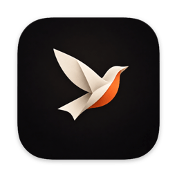
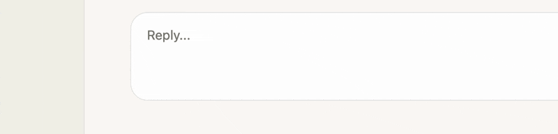
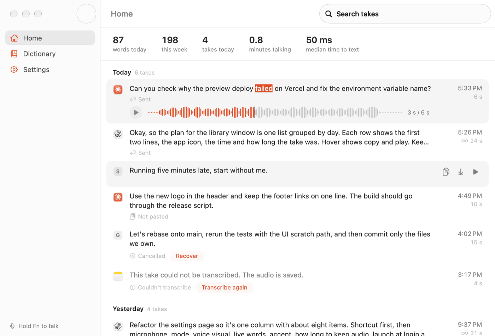
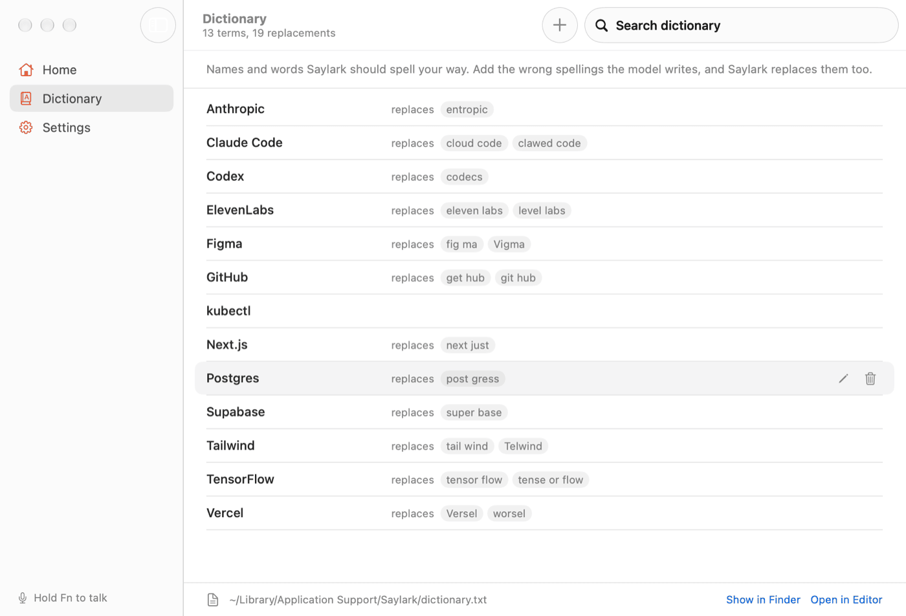
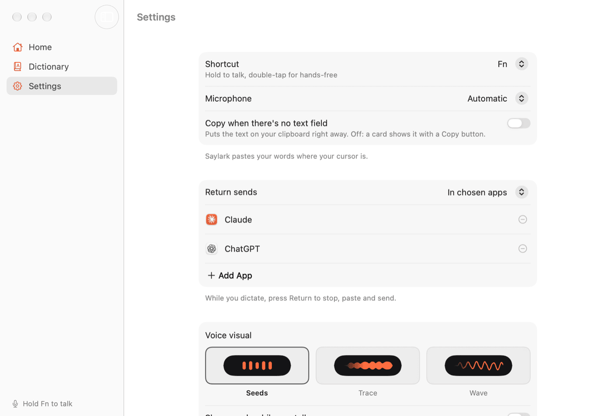

<div align="center">



# Saylark

**Dictation for talking to coding agents: hold a key, talk, press Return to send. Runs on your Mac.**

Hold Fn, talk, let go. Your words land at the cursor, exactly as you said them.
In Claude, Codex or ChatGPT, press Return mid-take and Saylark sends the message. Free, MIT licensed, no account.

[](#requirements)
[](#requirements)
[](LICENSE)
[](https://github.com/btahir/saylark/releases/latest)

[**Download Saylark.dmg**](https://github.com/btahir/saylark/releases/latest/download/Saylark.dmg) · [Website](https://saylark.shiptiffin.app) · [How it works](#how-it-works) · [Build from source](#build-from-source)

<br>



</div>

<br>

<picture>
  <source media="(prefers-color-scheme: dark)" srcset="docs/images/home-dark.png">
  
</picture>

## What it does differently

- **Return sends.** While you dictate, press Return: Saylark stops, pastes and presses Return for you, so one take becomes one sent message. On by default in the Claude, Codex and ChatGPT desktop apps; you choose the apps, or turn it on everywhere.
- **Your exact words.** There is no AI rewriting step. Saylark removes fillers (um, uh, er, hmm) and stutter repeats ("the the"), turns "new line" and "new paragraph" into line breaks, and applies your dictionary. Everything else is typed as you said it. See [Literal text](#literal-text).
- **Never loses a take.** Audio is written to disk while you talk and is recovered after a crash. Cancelled and failed takes stay on Home, where you can paste or transcribe them again.
- **A dictionary that's a plain text file.** Names and jargon the model should spell your way. Edit it in the app, in any editor, with `saylark dict`, or [let your agent keep it up to date](#let-your-agent-maintain-it).

## The basics

- **Hold to talk, double-tap for hands-free.** The trigger is Fn, Right Option or Right Command. Esc cancels.
- **Pastes at the cursor**, then puts your own clipboard back. With no text field focused, a card holds your words: copy them, or paste them into the next field you click.
- **Speech recognition runs on your Mac.** The app's only network use is downloading its models. No account, no telemetry. See [Privacy](#privacy).
- **Quiet.** A menu bar app with one window (Home, Dictionary, Settings). It shows in the Dock only while that window is open.

## Download

[**Saylark.dmg**](https://github.com/btahir/saylark/releases/latest/download/Saylark.dmg) (latest release, signed and notarized by Apple). Open it and drag Saylark to Applications. All versions are on the [releases page](https://github.com/btahir/saylark/releases), each with a SHA-256 checksum file.

### Requirements

- macOS 26 or later
- A Mac with Apple Silicon (M1 or later). Intel Macs are not supported.
- About 700 MB of free disk space for the speech models

On first launch Saylark downloads its speech model, about 600 MB, once. Onboarding shows the progress. After that, dictation works offline.

### First launch

Onboarding walks you through four macOS permissions. Each one has a reason:

| Permission | Why |
| --- | --- |
| Microphone | To hear you while you dictate |
| Input Monitoring | To see the trigger key (Fn, Right Option or Right Command) |
| Accessibility | To paste into the app you are using and press Return for "Return sends" |
| Clipboard ("Always Allow") | To put your own clipboard contents back after a paste |

Then try a take in the practice field, and you're set.

## How it works

1. **You hold the key.** Saylark starts recording right away and shows a small pill at the bottom of the screen.
2. **Recognition runs as you talk.** [Parakeet](#credits), a 0.6B-parameter speech model, runs on the Neural Engine through [FluidAudio](https://github.com/FluidInference/FluidAudio). A voice activity model splits long takes at pauses, so most of the work is done before you let go.
3. **You let go.** Saylark finishes the last few words, applies your dictionary, adds paragraph breaks at long pauses, and pastes. Home shows how long each take took to turn into text.
4. **Your clipboard comes back.** Saylark pastes through the clipboard, then restores what was there.

The floating pill shows your voice level while you talk (three styles: Seeds, Trace, Wave). Turn on "Show words while you talk" to see the words as they are recognized, as in the animation above.

## Literal text

Saylark types what the speech model heard, with a small, fixed cleanup that only removes things:

- Fillers (um, uh, er, hmm and their spellings) are dropped.
- Stutter repeats of one to three words ("the the", "I think I think") are collapsed. Doubles that are usually meant ("very very", "had had") are kept.
- "New line" and "new paragraph" become line breaks.
- Your [dictionary](#dictionary) fixes the spelling of names and jargon.

Numbers, units, addresses and identifiers are never touched. There is no language model that rephrases, summarizes or "polishes" your words, so a prompt to an agent says what you said.

## Dictionary

<picture>
  <source media="(prefers-color-scheme: dark)" srcset="docs/images/dictionary-dark.png">
  
</picture>

Names and jargon the model should spell your way live in one plain text file:

```
~/Library/Application Support/Saylark/dictionary.txt
```

```
# Lines starting with # are comments.
Kubernetes: cooper netties, cube or nettys
Supabase: super base
Tailwind
kubectl
```

- `Term` on its own means "spell it this way". Saylark fixes case and spacing ("tail wind" becomes Tailwind).
- `Term: wrong spelling, wrong spelling` also lists what the model writes instead. Those spellings are replaced with the term (the Dictionary tab calls them replacements).
- Edit it on the Dictionary tab, in any editor, or with `saylark dict`. Saylark picks up a change within about a second; no restart.
- A line it can't read (no term before the colon, a comma in the term) is skipped and left as you wrote it. The Dictionary tab and `saylark dict list` show skipped lines.

Saylark is careful with ordinary words. A term that is also an English word gets no case or sound-alike fixes, and a replacement made only of ordinary words is used only when the model was unsure of those words. All-lowercase terms (`kubectl`) get the stricter rules too.

Once your dictionary has terms, Saylark downloads a second, small model (about 100 MB) that helps it spot them in what you said.

### Let your agent maintain it

The dictionary is a text file, so a coding agent can keep it current. One way, if you use Claude Code or Codex: schedule a daily job (cron, launchd, or the agent's own scheduler) with a prompt like this:

> Read the messages I sent today (for example my git commit messages, or a "sent" folder I point you to). List product names, people, tools and jargon I wrote that a speech model would likely misspell. Skip ordinary English words. For each new one, run `saylark dict add "<Term>"`, adding `--as "<likely mishearing>"` only when you are confident of the mishearing. Do not remove or change existing lines. Report what you added.

Give the job read access only to the sources you choose, and review its first few runs. Saylark itself never reads your messages.

## Privacy

What Saylark does, from the code:

- **Speech stays on your Mac.** Recording, recognition and the dictionary all run locally. Your audio and text are never uploaded.
- **The only network use is downloading the speech models**, once, from huggingface.co: [`FluidInference/parakeet-ultra-coreml`](https://huggingface.co/FluidInference/parakeet-ultra-coreml) and [`FluidInference/silero-vad-coreml`](https://huggingface.co/FluidInference/silero-vad-coreml) on first launch, and [`FluidInference/parakeet-ctc-110m-coreml`](https://huggingface.co/FluidInference/parakeet-ctc-110m-coreml) once your dictionary has terms. They are stored in `~/Library/Application Support/FluidAudio/Models`.
- **No telemetry, analytics, accounts or crash reporting** in the app. (The website, saylark.shiptiffin.app, counts page visits with Umami, without cookies.)
- **Your history stays on disk, under your control.** Takes (text and audio) are kept in `~/Library/Application Support/Saylark/` so you can replay, copy or re-transcribe them. Audio is deleted after 30 days by default; Settings offers 1 day, 14 days, 30 days or forever. You can delete any take from Home.
- **Clipboard:** Saylark reads the clipboard only to restore your own contents after it pastes.
- **Microphone:** used only while you dictate, unless you turn on "Keep mic ready" under Advanced, which keeps it open (and the orange mic dot on) so takes start a little faster.

## Settings

<picture>
  <source media="(prefers-color-scheme: dark)" srcset="docs/images/settings-dark.png">
  
</picture>

Shortcut, microphone, copy when there's no text field, Return sends (and in which apps), voice visual, words while you talk, accent, how long to keep audio, launch at login and sounds. Keep mic ready and paragraphs from pauses are under Advanced.

## Command line

The `saylark` tool drives the same engine without the app. It is not in the DMG; build it from source:

```sh
swift build -c release --product saylark
cp .build/release/saylark /usr/local/bin/      # or anywhere on your PATH
```

```sh
saylark dict list                                   # your dictionary, and any skipped lines
saylark dict add Kubernetes --as "cooper netties"   # add a term, with a mishearing it replaces
saylark dict remove Kubernetes
saylark dict path                                   # where the file is
saylark transcribe clip.wav                         # transcribe an audio file (--json for word timings)
saylark doctor                                      # audio devices, permissions, trigger key clashes
```

Developer commands (`simulate`, `insert-test`, `bench`, `vocab`) are described in [docs/development.md](docs/development.md).

## Troubleshooting

**Nothing happens when I hold Fn.**
Check System Settings > Privacy & Security > Input Monitoring and make sure Saylark is on. macOS sometimes needs the app reopened after you grant it. `saylark doctor` lists what is missing.

**Two apps paste the same words.**
Another dictation app (or macOS Dictation) also listens to Fn. Quit the other app, turn off its Fn shortcut, or pick Right Option or Right Command in Saylark's Settings. Saylark warns you in Settings when it sees a clash.

**The pill shows my words but nothing is pasted.**
Saylark needs Accessibility to paste. Turn it on in System Settings > Privacy & Security > Accessibility. If no field was focused, the card still has your words: copy them, or paste into the next field you click. Home keeps every take too.

**macOS asks about "paste from other apps" every time.**
Choose "Always Allow" for Saylark. It reads the clipboard only to put your contents back after a paste. Settings shows the current state and a button to fix it.

**The microphone isn't picked up, or the wrong one is.**
Check Microphone in System Settings > Privacy & Security, then pick the input in Saylark's Settings (Automatic follows the macOS default). If the mic goes quiet mid-take, the pill says so.

**The first take after install is slow, or onboarding says the model is loading.**
The first launch downloads about 600 MB and then compiles the model for the Neural Engine. That happens once. If the download fails, check your connection and press Try Again.

**Saylark lost my permissions after I rebuilt it from source.**
macOS ties permissions to the app's signature. Sign every build with the same certificate (see below).

## Build from source

Needs macOS 26, Xcode 26 or its Command Line Tools (Swift 6.2), and Apple Silicon.

```sh
git clone https://github.com/btahir/saylark.git
cd saylark
source scripts/env.sh      # works around a stale PackageDescription in some Command Line Tools installs
swift build
scripts/test.sh            # the test suite
scripts/bundle.sh          # builds build/Saylark.app (release, signed)
```

`bundle.sh` signs with the Developer ID certificate in your keychain, so macOS keeps Saylark's permissions across rebuilds. Without one, run `ALLOW_ADHOC=1 scripts/bundle.sh`; an ad hoc build works, but macOS asks for the permissions again after every rebuild. Copy `build/Saylark.app` to `/Applications` and open it.

Releases (signed, notarized DMG) are built with `scripts/release.sh`; see [RELEASING.md](RELEASING.md).

### Project layout

| Folder | What's in it |
| --- | --- |
| `Sources/SaylarkCore` | Pure Swift: the key gesture state machine, text cleanup, the dictionary, alignment. No AppKit. |
| `Sources/SaylarkEngine` | Audio capture, voice activity, Parakeet via FluidAudio, history, paste, crash recovery. |
| `Sources/SaylarkUI` | The window, onboarding, settings and the pill (AppKit, SwiftUI, Core Animation). |
| `Sources/SaylarkApp` | The menu bar app. |
| `Sources/SaylarkCLI` | The `saylark` command line tool. |
| `Tests/` | Swift Testing suites for each module. |

## Contributing

Issues and pull requests are welcome. Before a pull request:

- Run `scripts/test.sh` and keep it green.
- Keep changes small and focused, and describe what you tested.
- For UI changes, include a before/after screenshot. `docs/development.md` shows how to render every screen offscreen with sample data.

Never commit recordings, transcripts or a personal dictionary; `.gitignore` keeps the usual places out.

## Credits

- Speech model: [Parakeet Ultra](https://huggingface.co/FluidInference/parakeet-ultra-coreml), Moondream's post-training of NVIDIA Parakeet TDT 0.6B, CC-BY-4.0.
- Voice activity: [Silero VAD](https://github.com/snakers4/silero-vad), MIT.
- Spelling model: NVIDIA Parakeet CTC 110M, CC-BY-4.0.
- Core ML conversions and runtime: [FluidAudio](https://github.com/FluidInference/FluidAudio) by FluidInference, Apache-2.0.
- Storage: [GRDB.swift](https://github.com/groue/GRDB.swift), MIT.

Full notices are in [packaging/THIRD_PARTY_NOTICES.txt](packaging/THIRD_PARTY_NOTICES.txt), in the app (About Saylark) and on the disk image.

## License

[MIT](LICENSE)

<br>

<p align="center">
  <sub>Sponsored by <a href="https://shiptiffin.app"> ShipTiffin</a></sub>
</p>
